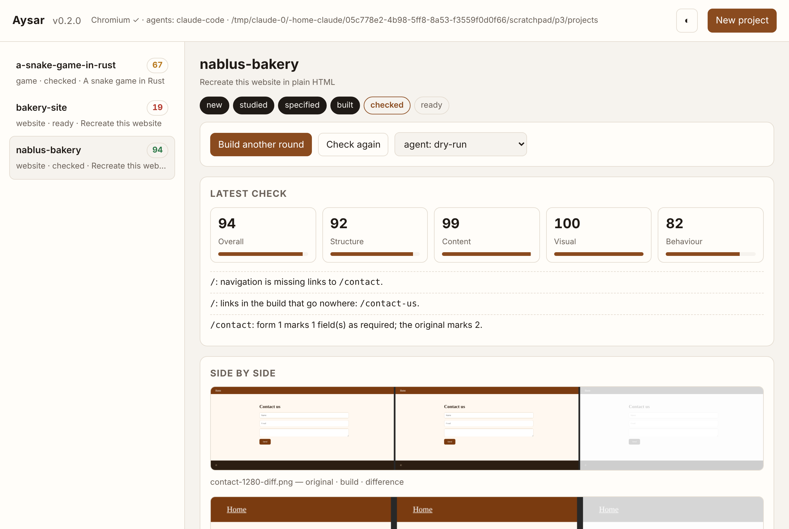

# أيسر — Aysar

[English](README.md) · **العربية**

**افهم كيف يعمل أي موقع أو تطبيق أو لعبة، ثم دع وكيلًا برمجيًا يبني نسختك الخاصة — من الأدلة، عبر مواصفة قابلة للمراجعة، ومفحوصة مقابل الأصل في متصفح حقيقي.**

أيسر محرك مفتوح المصدر مكتوب بالكامل بـ Rust. وجّهه نحو هدف، قل ما تريد، وهو:

1. **يدرس** الأصل: البنية والنص والنماذج، وفي Chromium بلا واجهة: لقطات شاشة على عروض 360/768/1280px، الألوان والخطوط ومقياس الحروف والمسافات المقيسة، مواضع كل منطقة، أي الروابط تعمل، كيف تتحقق النماذج من المدخلات، ما الذي يتغير عند التحويم. وضع Clean room افتراضيًا: ما يراه الزائر فقط.
2. **يكتب مواصفة** (Spec): ملف وسيط مقروء وقابل للتعديل تراجعه وتغيّره قبل كتابة سطر كود واحد.
3. **يبني** مشروعًا جديدًا بالوكيل البرمجي الموجود عندك: Claude Code أو Codex أو Aider أو Gemini CLI أو opencode أو goose أو أي أمر. وعدة وكلاء معًا إن شئت؛ أفضل مرشح يفوز.
4. **يفحص** النتيجة مقابل الأصل: البنية، المحتوى، المظهر المعروض فعليًا، والسلوك، ويسرد ما لا يتطابق بعد بجمل واضحة مع صور جنبًا إلى جنب.
5. **يحسّن** حتى تبلغ الدرجة الهدف.

كل ادّعاء يُسجَّل في سجل أدلة مع مصدره ودرجة ثقته. ولوحة تحكم محلية تعرض كل شيء.



## لماذا أيسر؟

أدوات مثل [Craft Anything](https://github.com/storytold/craft-anything) أثبتت الفكرة: ادرس، ابنِ، افحص. أيسر يبني عليها ويختلف في خمسة أمور:

- **مواصفة في المنتصف:** دراسة → **مواصفة** → بناء. المواصفة ملف تقرؤه وتقارنه وتعدّله؛ الباني يعمل منها لا من ملفات الأصل ولا من مخرجات الأدوات الخام.
- **فحص مع الأسباب:** كل اختلاف جملة قابلة للتنفيذ (`/contact: form 1 marks 1 field(s) as required; the original marks 2`)، مجمّعة حسب العرض، مع صور «الأصل | البناء | الفرق»، وتُغذّى مباشرة في جولة البناء التالية.
- **حيادية الوكيل:** واجهة `Agent` واحدة. Claude Code وCodex وخمسة إعدادات جاهزة مدمجة، وأي وكيل آخر بقالب أمر واحد. `--agents a,b` يُسابق بينها. وضع dry-run يعمل بلا أي ذكاء اصطناعي.
- **سجل أدلة:** ملاحظات واستنتاجات وفحوص وقرارات، لكل منها مصدر ودرجة ثقة، تُستعلم من سطر الأوامر ومن اللوحة.
- **محركات لا إعادة كتابة:** التفكيك والترجمة العكسية مفوّضة لمحركات موجودة خلف واجهة `Engine` واحدة.

## البدء السريع

يتطلب Rust 1.80 أو أحدث. للقطات الشاشة والقياسات والفحص البصري والسلوكي يلزم Chrome أو Chromium على الجهاز (يُكتشف تلقائيًا، أو عيّن `AYSAR_CHROME`). كل ما عداه يعمل بدونه.

```bash
git clone https://github.com/lord10110/aysar_v && cd aysar
cargo install --path apps/aysar-cli      # يثبّت الأمر `aysar`
aysar doctor                             # ما المثبّت، وأين تذهب المشاريع
aysar ui                                 # لوحة التحكم على 127.0.0.1:7331
```

دراسة فقط (دون إنشاء مشروع أو بناء):

```bash
aysar study https://example.com
aysar study ./مجلد-موقع --deep --out capture.json
aysar identify ./ملف-تنفيذي
```

إعادة بناء:

```bash
aysar rebuild https://example.com "أعد بناء هذا الموقع بـ HTML بسيط"
aysar rebuild - "لعبة ثعبان بلغة Rust مع Bevy" --kind game
aysar rebuild ./موقعي-القديم "أعد بناءه بـ Astro وTailwind" --agents claude-code,codex --rounds 3
```

ثم على مجلد المشروع الذي يطبعه:

```bash
aysar status   <project>        # المرحلة والدرجة والمرشحون والتاريخ
aysar check    <project>        # إعادة الفحص بعد تعديل يدوي (يضيف الصور إلى checks/)
aysar build    <project>        # جولة تحسين إضافية
aysar enrich   <project>        # دع نموذجًا محليًا يضيف الأغراض والسلوكيات
aysar evidence <project> --kind check
```

مقارنة أي موقعين دون مشروع:

```bash
aysar compare https://original.example ./my-build
```

مرجع الأوامر الكامل في [docs/CLI.md](docs/CLI.md).

### Clean room أو Deep

- **Clean room** (الافتراضي): يقرأ ما يراه الزائر فقط: العناوين، الترويسات، الروابط، النماذج، النص الظاهر، المعالم، عدد الصور، وما تبدو عليه الصفحة المعروضة وتفعله (لقطات، ألوان وخطوط ومسافات مقيسة، تخطيط، روابط تعمل، تحقق النماذج، حالات التحويم والتركيز). لا يقرأ الأنماط ولا السكربتات ولا المصدر ولا الملفات التنفيذية.
- **Deep** (`--deep`): يقرأ كل شيء لاستخدامك الخاص: الأنماط، السكربتات، HTML الخام، والملفات التنفيذية عبر محرك التحليل.

### البُناة

أيسر لا يحمل ذكاءً اصطناعيًا بداخله؛ خطوة البناء تحتاج *بانيًا*. ثلاثة طرق من الأسهل إلى الأقوى:

**1. الباني المدمج `api` — أي نموذج، بما فيه نموذج محلي بالكامل.** لا برنامج إضافي. وجّهه إلى أي خادم متوافق مع OpenAI فيطلب من النموذج المشروع كاملًا كملفات.

```bash
# محلي بالكامل بلا حساب: ثبّت Ollama (https://ollama.com) ثم
ollama pull qwen2.5-coder:7b
aysar rebuild https://example.com "Recreate this website" --agent api

# أو نموذج مستضاف (OpenAI، OpenRouter، Groq…)
AYSAR_LLM_URL=https://openrouter.ai/api/v1 AYSAR_LLM_MODEL=qwen/qwen-2.5-coder-32b-instruct AYSAR_LLM_KEY=sk-… \
  aysar rebuild https://example.com "Recreate this website" --agent api
```

ضع هذه القيم في `aysar config --init` تحت `[llm]` ليصبح `api` الافتراضي. نموذج 7B يكفي المواقع الصغيرة؛ 14B–32B أفضل بوضوح. الباني المدمج يناسب المواقع والتطبيقات الصغيرة؛ لا يستطيع تشغيل أوامر أو اختبارات بنفسه، فللألعاب والتطبيقات الكبيرة يتفوق وكيل برمجي (أدناه).

**2. وكيل برمجي على جهازك.** يشغّله أيسر بحسابك أنت ولا يلمس حسابك.

| الوكيل | الأمر الذي يشغّله أيسر | الحالة |
|---|---|---|
| `claude-code` | `claude -p <prompt> --permission-mode acceptEdits` | **مُجرَّب فعليًا**: إعادة بناء كاملة للموقع النموذجي بدرجة 92/100 من الجولة الأولى |
| `codex` | `codex exec --sandbox workspace-write --skip-git-repo-check <prompt>` | الأعلام مُتحقَّق منها على v0.166 (مثبّت ومُشغَّل؛ يتوقف عند تسجيل الدخول) |
| `gemini` | `gemini --yolo -p <prompt>` | الأعلام مُتحقَّق منها على v0.66 |
| `opencode` | `opencode run <prompt>` | الأعلام مُتحقَّق منها على v1.19 |
| `qwen` | `qwen --yolo <prompt>` | الأعلام مُتحقَّق منها على v0.26 |
| `aider` | `aider --message-file {prompt_file} --yes --no-git --no-auto-commits` | من التوثيق (يحتاج Python ≤ 3.12) |
| `goose` | `goose run --text <prompt>` | من التوثيق |
| أي وكيل | `--agent "your-cmd --file {prompt_file}"` | — |
| `api` | مدمج؛ `AYSAR_LLM_URL` / `AYSAR_LLM_MODEL` / `AYSAR_LLM_KEY` | مُتحقَّق منه على خادم محاكٍ متوافق مع OpenAI؛ بروتوكول الملفات نص بسيط تتبعه النماذج الصغيرة |
| `dry-run` | يكتب `app/BUILD-PROMPT.md` ويتوقف | مُجرَّب |

**3. بلا أي بانٍ** — `dry-run` يكتب الأمر الكامل في `app/BUILD-PROMPT.md`؛ ألصقه في أي نموذج محادثة وضع الملفات التي يعيدها في `app/`، ثم `aysar check`.

«الأعلام مُتحقَّق منها» تعني أننا ثبّتنا الأداة وشغّلنا الأمر نفسه: يُفهَم ويصل حتى طلب حسابك. `aysar doctor` يعرض مستوى التحقق لكل وكيل.

### التطبيقات والألعاب

في وضع Deep يُدرَس البرنامج أو حزمة التطبيق أو بناء اللعبة عبر محرك التحليل ([craft-anything-cli](https://github.com/storytold/craft-anything)): ما هو، اعتمادياته واستيراداته، عدد الدوال والسلاسل، النصوص التي يعرضها، ولحزم Android وJava و.NET وApple: المكوّنات والفئات والموارد. يدخل ذلك في قسم **Program** من المواصفة؛ لا يُنسخ أي كود.

```bash
aysar --deep rebuild ./some-app.exe "أعد بناءه كتطبيق Tauri" --kind app
aysar --deep rebuild ./game.apk "أعد بناء هذه اللعبة في Godot" --kind game
```

المواقع تُقاد في متصفح. أما التطبيقات والألعاب فيُطلب من الباني أن يضيف `aysar-build.json`:

```json
{ "run": "cargo run --release", "selftest": "cargo test --release", "notes": "…" }
```

`check` يشغّل الاختبار الذاتي بلا واجهة مع مهلة؛ سطور `PASS …` / `FAIL …` تصبح درجة السلوك وقائمة الاختلافات. الألعاب توثّق قواعدها أيضًا في `GAMEPLAY.md`.

### للوكلاء (MCP)

```bash
aysar setup                               # يطبع مقطع الإعداد
claude mcp add aysar -- aysar mcp         # لـ Claude Code بسطر واحد
```

### الإعدادات

`aysar config --init` يكتب `~/.config/aysar/config.toml` (مجلد المشاريع، الوكيل الافتراضي، مسار Chromium، الجولات، الدرجة الهدف، نقطة النموذج لـ `enrich`). الأعلام ومتغيرات `AYSAR_*` تتجاوزه.

## بنية المشروع على القرص

```
~/Documents/Aysar/<name>/
  aysar.json          الطلب والهدف والوضع والمرحلة والدرجة والمرشحون والتاريخ
  capture/            capture.json، screenshots/<page>-<width>.png (+ raw/ في Deep)
  spec/               spec.json، spec.md، prompt-round-N.md
  app/                المشروع المولَّد (aysar-build.json للتطبيقات والألعاب)
  candidates/<agent>/ مجلد لكل وكيل متنافس عند استخدام --agents
  checks/             check-NNN.json / .md، check-NNN-screenshots/*-diff.png
  evidence/           ledger.jsonl
  inbox/              أسئلة مفتوحة لك
```

## الحالة

بيتا. كل ما في البدء السريع يعمل اليوم ومغطّى بالاختبارات (وحدات، Chromium حي، واختبارات صندوق أسود لسطر الأوامر) ومصفوفة GitHub Actions على Linux وmacOS وWindows. انظر [CHANGELOG.md](CHANGELOG.md).

جُرِّب فعليًا في هذا الإصدار: الدورة الكاملة مع Claude Code بانيًا (92/100 من الجولة الأولى)، ودراسة البرامج في وضع Deep عبر craft-anything-cli 0.4.0 على ملف ELF حقيقي.

لم يُنجز بعد: إعادة تشغيل تفاعلات مسجَّلة على تطبيق مبني، رحلات المستخدم متعددة الخطوات، غلاف مكتبي أصلي، وتشغيل Codex/Gemini/opencode/Qwen/Aider حتى النهاية (أوامرهم مُتحقَّق منها؛ تحتاج تسجيل دخولك).

## الاستخدام المسؤول

استخدم أيسر على برامج تملكها أو مصرح لك بفحصها. يحترم `robots.txt`، ولا يتجاوز تسجيل الدخول أو DRM أو حدود الطلبات أو أنظمة مكافحة الغش، ولا يرسل نموذجًا على موقع يدرسه أبدًا. البناء يعيد الهيكل والأسلوب والسلوك من الأدلة، ويُطلب من الباني عدم نسخ الشعارات أو الصور أو النصوص.

## الترخيص

مزدوج: [MIT](LICENSE-MIT) أو [Apache-2.0](LICENSE-APACHE) حسب اختيارك.
