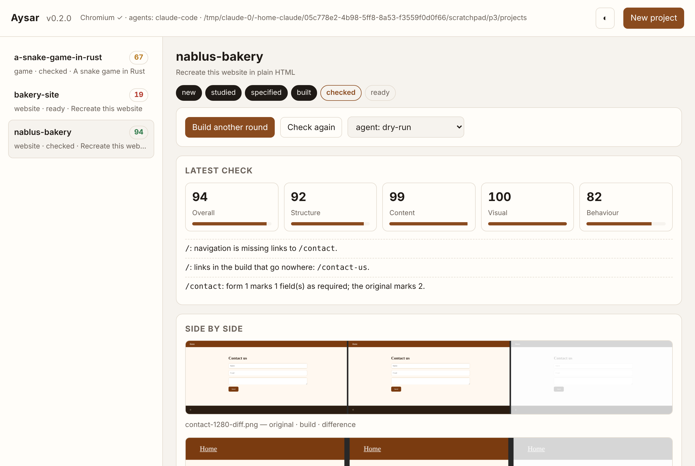

# Aysar

**English** · [العربية](README.ar.md)

**See how any website, app or game works, then have a coding agent build your own — from evidence, through a reviewable spec, checked against the original in a real browser.**

Aysar is an open-source engine in pure Rust. Point it at a target, say what you want, and it:

1. **Studies** the original: structure, text, forms, and — in headless Chromium — screenshots at 360/768/1280 px, measured colours, fonts, type scale, spacing, where every region sits, which links work, how forms validate, what changes on hover. Clean room by default: only what a visitor sees.
2. **Writes a spec** — a readable, editable intermediate specification you can review and change before a line of code is written.
3. **Builds** a new project with the coding agent you already have: Claude Code, Codex, Aider, Gemini CLI, opencode, goose, or any command. Several at once, if you like; the best candidate wins.
4. **Checks** the build against the original — structure, content, rendered look and behaviour — and lists what doesn't match yet, in plain sentences, with side-by-side pictures.
5. **Refines** until the score reaches your target.

Every claim is recorded in an evidence ledger with its source and confidence. A local dashboard shows it all.

[](#)
[](#license)
[](docs/ROADMAP.md)



## Why Aysar

Tools like [Craft Anything](https://github.com/storytold/craft-anything) proved the idea: study, build, check. Aysar builds on it and differs in five places:

| | Aysar |
|---|---|
| **Spec in the middle** | Study → **Spec** → Build. The spec is a file you can read, diff and edit. The builder works from the spec, never from raw tool dumps or the original's files. |
| **Checked, with reasons** | Every mismatch is an actionable sentence — `/contact: form 1 marks 1 field(s) as required; the original marks 2` — grouped by width, with original \| build \| difference pictures. Checks feed straight back into the next build round. |
| **Agent-agnostic** | One `Agent` trait. Claude Code, Codex and five presets are built in; any other agent is one command template away. `--agents a,b` races them. Dry-run mode works with no AI at all. |
| **Evidence ledger** | Observations, inferences, checks and decisions, each with a source and confidence, queryable from the CLI and the dashboard. |
| **Engines, not rewrites** | Disassembly and decompilation are delegated to existing engines behind one `Engine` trait. Aysar's own code is orchestration, spec, verification, rendering and the gateway. |

## Quick start

Requires Rust 1.80+. For screenshots, measured styles, visual and behaviour checks, a Chrome or Chromium on the machine (found automatically; or set `AYSAR_CHROME`). Everything else works without it.

```bash
git clone https://github.com/lord10110/aysar_v && cd aysar
cargo install --path apps/aysar-cli      # installs `aysar`
aysar doctor                             # what's installed, where projects go
aysar ui                                 # the dashboard, on 127.0.0.1:7331
```

Study something (no project created, nothing built):

```bash
aysar study https://example.com
aysar study ./some-site-folder --deep --out capture.json
aysar identify ./some-binary
```

Rebuild something:

```bash
aysar rebuild https://example.com "Recreate this website in plain HTML"
aysar rebuild - "A snake game in Rust with Bevy" --kind game
aysar rebuild ./my-old-site "Rebuild this with Astro and Tailwind" --agents claude-code,codex --rounds 3
```

Then, on the project folder it prints:

```bash
aysar status   <project>        # stage, score, candidates, history
aysar check    <project>        # re-check after manual edits (adds pictures to checks/)
aysar build    <project>        # one more refinement round
aysar enrich   <project>        # let a local model add purposes and behaviours
aysar evidence <project> --kind check
```

Compare any two sites without a project:

```bash
aysar compare https://original.example ./my-build
```

The full command reference is in [docs/CLI.md](docs/CLI.md).

### Clean room or Deep

- **Clean room** (default): Aysar reads only what a visitor sees — titles, headings, links, forms, visible text, landmarks, image counts, and what the rendered page looks like and does (screenshots, measured colours, fonts, spacing, layout, working links, form validation, hover and focus states). Stylesheets, scripts, source and binaries are **not** read. Tools that would look inside refuse and tell you how to switch.
- **Deep** (`--deep`): everything is read, for your private use — styles, scripts, raw HTML, and binaries through the analysis engine.

### Builders

Aysar has no AI of its own; the Build step needs a *builder*. Three ways, from easiest to most capable:

**1. The built-in `api` builder — any model, including a fully local one.** No extra program. Point it at any OpenAI-compatible server and it asks the model for the whole project as files.

```bash
# Fully local, no account: install Ollama (https://ollama.com), then
ollama pull qwen2.5-coder:7b
aysar rebuild https://example.com "Recreate this website" --agent api

# Or a hosted model (OpenAI, OpenRouter, Groq, …)
AYSAR_LLM_URL=https://openrouter.ai/api/v1 AYSAR_LLM_MODEL=qwen/qwen-2.5-coder-32b-instruct AYSAR_LLM_KEY=sk-… \
  aysar rebuild https://example.com "Recreate this website" --agent api
```

Put these in `aysar config --init` under `[llm]` to make `api` the default. A 7B coding model handles small sites; 14B–32B do noticeably better. The built-in builder is best for websites and small apps; it cannot run commands or tests itself, so for games and larger apps a coding agent (below) wins.

**2. A coding agent on your machine.** Aysar runs *your* agent with *your* sign-in and never handles your account.

| Agent | Command Aysar runs | Status |
|---|---|---|
| `claude-code` | `claude -p <prompt> --permission-mode acceptEdits` | **verified live**: a full rebuild of the sample site scored 92/100 in one round |
| `codex` | `codex exec --sandbox workspace-write --skip-git-repo-check <prompt>` | flags verified against v0.166 (installed and invoked; stops at sign-in) |
| `gemini` | `gemini --yolo -p <prompt>` | flags verified against v0.66 |
| `opencode` | `opencode run <prompt>` | flags verified against v1.19 |
| `qwen` | `qwen --yolo <prompt>` | flags verified against v0.26 |
| `aider` | `aider --message-file {prompt_file} --yes --no-git --no-auto-commits` | from the docs (needs Python ≤ 3.12 to install) |
| `goose` | `goose run --text <prompt>` | from the docs |
| anything | `--agent "your-cmd --file {prompt_file}"` | — |
| `api` | built-in; `AYSAR_LLM_URL` / `AYSAR_LLM_MODEL` / `AYSAR_LLM_KEY` | verified against an OpenAI-compatible mock server; the file protocol is plain text so small local models follow it |
| `dry-run` | writes `app/BUILD-PROMPT.md` and stops | verified |

**3. No builder at all** — `dry-run` writes the complete prompt to `app/BUILD-PROMPT.md`; paste it into any chat model and drop the files it returns into `app/`, then `aysar check`.

"Flags verified" means we installed the tool and ran the exact command: it parses and gets as far as asking for your account. Override any with `AYSAR_AGENT_<NAME>`; `aysar doctor` shows which are installed and the verification level of each.

### Apps and games

In Deep mode, a program, app package or game build is studied through the analysis engine ([craft-anything-cli](https://github.com/storytold/craft-anything), found on `PATH` or via `AYSAR_CRAFT_ANYTHING_BIN`): what it is, its dependencies and imports, function and string counts, the text it shows, and — for Android, Java, .NET and Apple packages — components, classes and resources. That goes into the spec's **Program** section; no code is copied.

```bash
aysar --deep rebuild ./some-app.exe "Recreate this as a Tauri app" --kind app
aysar --deep rebuild ./game.apk "Recreate this game in Godot" --kind game
```

Websites are driven in a browser. For apps and games the builder is asked to ship an `aysar-build.json`:

```json
{ "run": "cargo run --release", "selftest": "cargo test --release", "notes": "…" }
```

`check` runs the self-test headlessly with a timeout; `PASS …` / `FAIL …` lines become the behaviour score and the mismatch list. Games must also document their rules in `GAMEPLAY.md`.

### For agents (MCP)

Every tool is also an MCP tool. Register Aysar once and any MCP client (Claude Code, Codex, Cursor, …) can study, rebuild and check:

```bash
aysar setup                               # prints the config snippet
claude mcp add aysar -- aysar mcp         # Claude Code, one line
```

### Configuration

`aysar config --init` writes `~/.config/aysar/config.toml` (projects folder, default agent, Chromium path, rounds, target score, model endpoint for `enrich`). Flags and `AYSAR_*` variables override it.

## Project layout

```
~/Documents/Aysar/<name>/
  aysar.json          request, target, mode, stage, score, candidates, history
  capture/            capture.json, screenshots/<page>-<width>.png (+ raw/ in Deep mode)
  spec/               spec.json, spec.md, prompt-round-N.md
  app/                the generated project (aysar-build.json for apps and games)
  candidates/<agent>/ one folder per competing agent, when --agents was used
  checks/             check-NNN.json / .md, check-NNN-screenshots/*-diff.png
  evidence/           ledger.jsonl
  inbox/              open questions for you
```

## Repository layout

```
crates/
  aysar-core          Mode, Target, Capture (+ viewports, styles, probes), Spec, Evidence, Project
  aysar-capture       websites over HTTP (robots.txt, polite delay) and local HTML
  aysar-render        headless Chromium: screenshots, layout boxes, measured styles, link/form/hover probes, diff pictures, static server
  aysar-analysis      Engine trait + craft-anything adapter + file identification
  aysar-spec          capture → spec (deterministic), design-system extraction
  aysar-enrich        optional model enrichment through any OpenAI-compatible endpoint
  aysar-build         Agent trait, Claude Code / Codex / presets / templates / dry run, prompt builder
  aysar-verify        structure + content + visual + behaviour comparison, actionable mismatches
  aysar-orchestrator  Study → Spec → Build → Check → Refine, candidates, self-tests, config
  aysar-mcp           stdio MCP server
  aysar-ui            local dashboard
apps/
  aysar-cli           the `aysar` binary (+ black-box tests)
docs/                 ARCHITECTURE, ROADMAP, SPEC-FORMAT, CLI
```

See [docs/ARCHITECTURE.md](docs/ARCHITECTURE.md) for how the pieces fit, [docs/SPEC-FORMAT.md](docs/SPEC-FORMAT.md) for the spec, and [docs/ROADMAP.md](docs/ROADMAP.md) for what's next.

## Status

Beta. Everything in the quick start works today and is covered by tests (unit, live-Chromium, and black-box CLI tests) and a GitHub Actions matrix on Linux, macOS and Windows. See [CHANGELOG.md](CHANGELOG.md).

Verified live in this release: the whole loop with Claude Code as the builder (92/100 first round on the sample site), and Deep-mode program study through craft-anything-cli 0.4.0 on a real ELF.

Not yet: replaying recorded interactions on a built app, multi-step user journeys in behaviour checks, a native desktop shell (the dashboard is a local web page), and running Codex/Gemini/opencode/Qwen/Aider end to end (their commands are verified; they need your sign-in).

## Responsible use

Use Aysar on software you own or are allowed to examine. It respects `robots.txt`, never bypasses logins, DRM, rate limits or anti-cheat, and never submits a form on a site it studies. Builds recreate structure, style and behaviour from evidence; the builder is told not to copy logos, photos or text.

## License

Dual-licensed under [MIT](LICENSE-MIT) or [Apache-2.0](LICENSE-APACHE), at your option. The name "Aysar" and any logo in `docs/brand/` are not covered by the code license.

## Credits

Inspired by, and designed to interoperate with, [Craft Anything](https://github.com/storytold/craft-anything) by the ArtCraft team.
